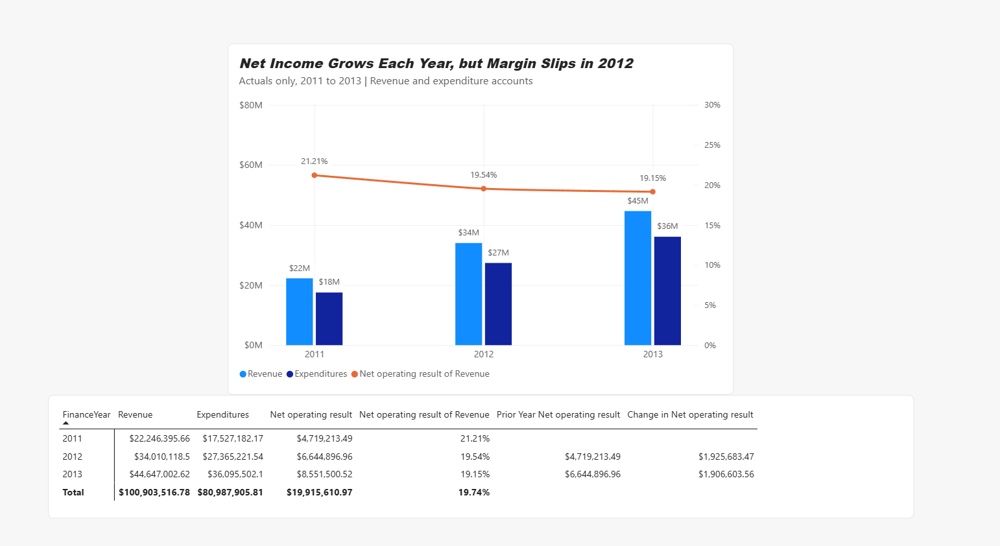
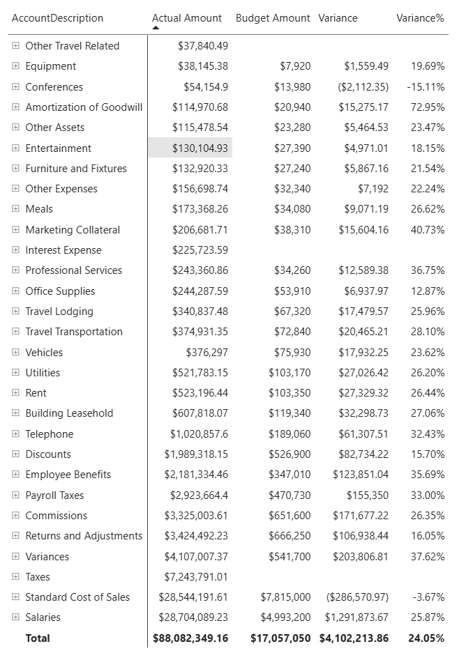
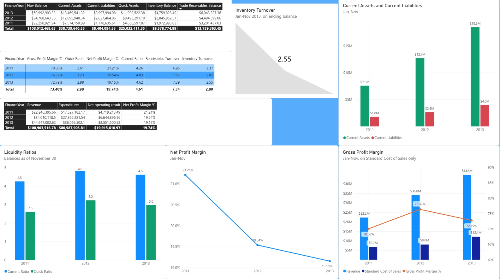
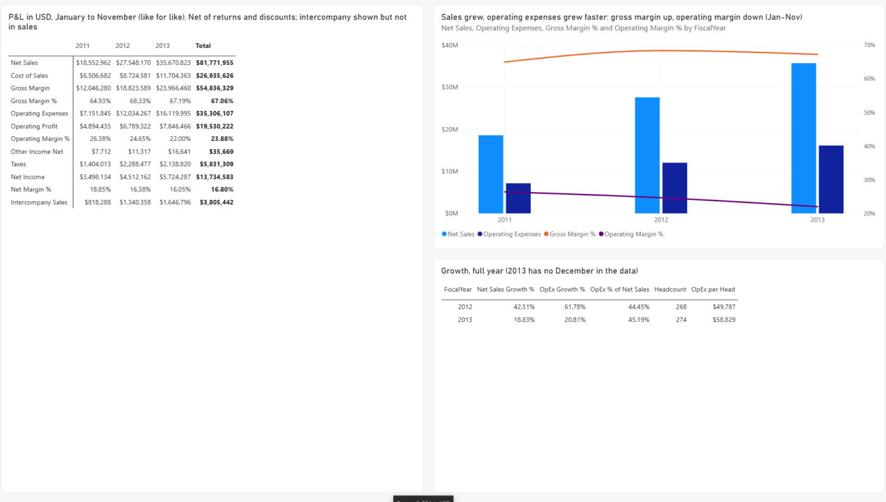
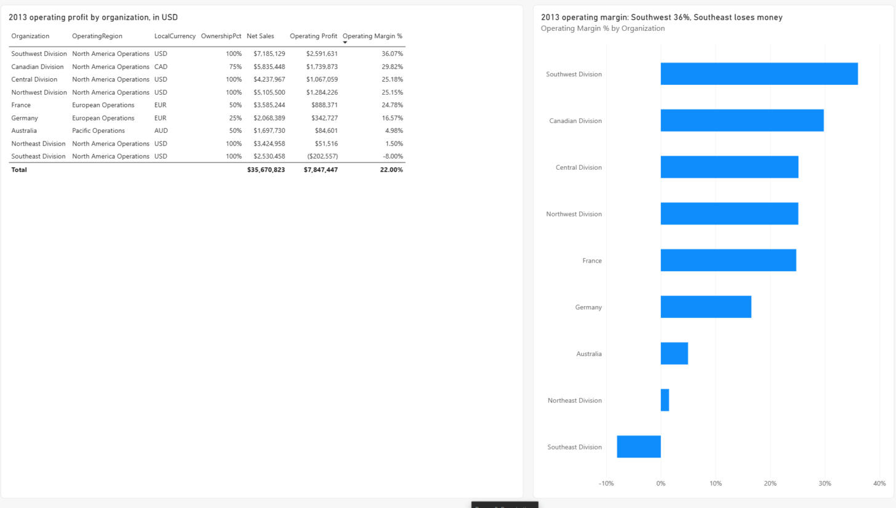
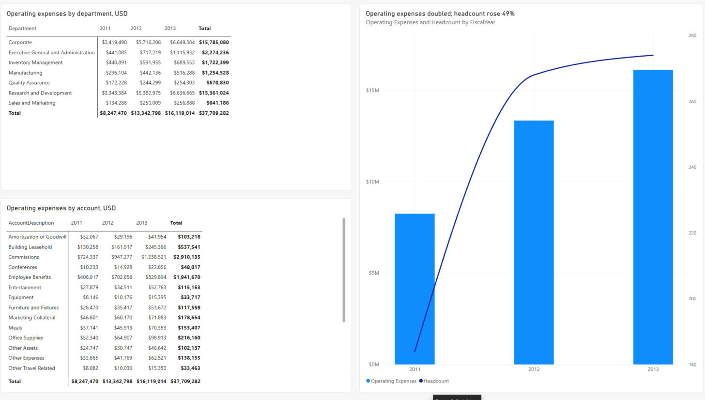
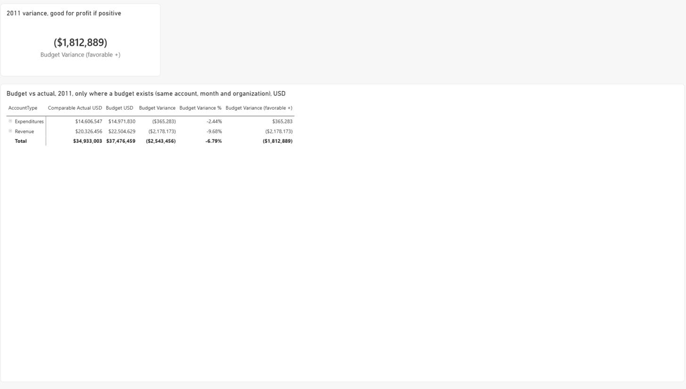
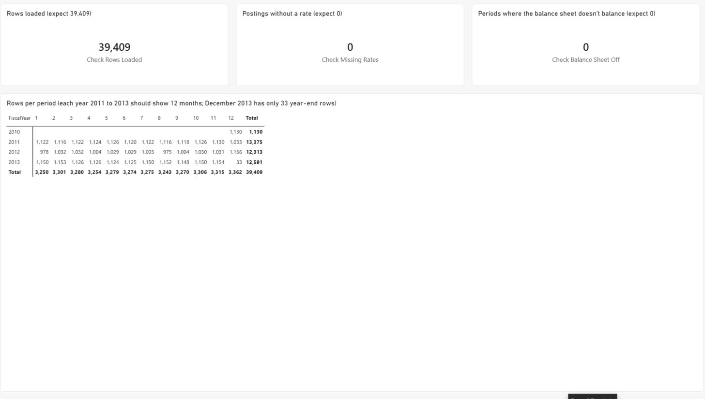

## Problem

To learn FP&A analysis end to end, I built a budget versus actual dashboard on AdventureWorks, Microsoft's sample data for a fictional bike manufacturer, and wrote up what I found on LinkedIn, mistakes included.

## The five questions I asked

1. **Variance:** how does actual spending compare to budget by account, and which accounts vary most?
2. **Trend:** how have revenue and expenditures moved year over year, and is the gap widening?
3. **Mix:** which account types take the largest share, and has the mix shifted?
4. **Consistency and health:** which results hold year after year, and what do the balance sheet ratios say?
5. **Forecastability:** which accounts follow a predictable pattern, and which are too volatile to forecast?

## Data

The AdventureWorksDW sample database in SQL Server: actuals by account for 2010 to 2013, with budgets for 2010 and 2011 only.

## Approach

1. Queried the finance tables in SQL Server and modeled them in Power BI.
2. Built DAX measures for actual versus budget variance and a run rate forecast for 2012 and 2013.
3. Checked the shape of the data before trusting the answer, and corrected my own posts when it was wrong.
4. Built the SQL and DAX with AI assistance, then read and tested every query and measure myself.

## What I caught

- **Wrong period count.** The first result showed accounts 265% to 658% over budget, because four years of actuals were summed against two years of budgets. A measure that counts actuals only in budgeted years fixed it.
- **A blank read as zero** produced a false $5.46M swing until an `ISBLANK` check fixed it.
- **Four data-shape problems:** a one-month year, a missing December, snapshot balance-sheet accounts, and zero rollup accounts. On a like-for-like January to November basis, net margin slid from 21.2% to 19.2%.

## Results

A backtested forecast (2013 predicted as 2012 plus the prior year's change) landed within 3.1% in total while missing many individual accounts. It is one test point per account, and a lesson about totals hiding detail.

{fig-alt="Bar and line chart of revenue, expenditures and net operating margin, 2011 to 2013, with a summary table below."}

{fig-alt="Table of actual amount, budget amount, variance and variance percent by expense account."}

{fig-alt="Dashboard of current and quick ratios, net and gross profit margin, inventory turnover and current assets versus liabilities, 2011 to 2013."}

## A deeper model

I then had Claude (AI) profile the whole database before modeling and rebuild the model from what it found. Every amount is in USD, returns and discounts are netted out of sales, intercompany sales are shown separately, and each posting sits in its true month. The results match SQL Server to the dollar. On that basis, gross margin rose from 2011 to 2013, but operating margin fell from 26.4% to 22.0% (January to November each year), because operating expenses grew faster than sales. The SQL, DAX and a checklist of what to verify are in the [repo's deeper-model folder](https://github.com/analysttom712/fpa-variance-forecast/tree/main/deeper-model).

{fig-alt="Matrix of net sales down to net income by year, a combo chart of net sales and operating expenses with gross and operating margin lines, and a growth table for 2012 and 2013."}

{fig-alt="Table of nine organizations with region, currency, ownership, net sales, operating profit and margin, next to a bar chart of operating margin by organization."}

{fig-alt="Two matrices of operating expenses by department and by account for 2011 to 2013, and a combo chart of operating expenses and headcount."}

{fig-alt="Card showing a variance of negative 1,812,889 dollars and a matrix of comparable actual, budget and variance by account type."}

{fig-alt="Three check cards reading 39,409, 0 and 0, and a matrix of row counts by fiscal year and month."}

## What the business should do

For the fictional company in Microsoft's sample data:

- Keep operating expenses growing no faster than sales. Expenses grew 95% against 69% sales growth, and operating margin fell from 26.4% to 22.0%.
- Review Southeast, which lost money (−8.0% operating margin) while Southwest earned 36.1%.
- Budget and forecast by account, not just in total. The total forecast landed within 3.1%, while many individual accounts missed.

## Tools

SQL Server (SSMS) · Power BI · DAX

## Write-ups

- [From Benefits to Business Questions: I Built an FP&A Variance Dashboard from Scratch](https://www.linkedin.com/pulse/budget-vs-actual-what-i-learned-building-fpa-dashboard-thomas-baynum-ldywe)
- [The Gap Between Revenue and Expenses. What the Data Said](https://www.linkedin.com/pulse/gap-between-revenue-expenses-what-data-said-thomas-baynum-cp2be)
- [I Almost Posted the Wrong Numbers: What a Power BI Project Taught Me About Trusting Data](https://www.linkedin.com/pulse/i-almost-posted-wrong-numbers-what-power-bi-project-taught-baynum-ewhke)

## Repo

[The Power BI project (PBIP and PBIX), SQL Server queries, DAX and a whole-database deeper model on GitHub](https://github.com/analysttom712/fpa-variance-forecast)

## The DAX

All 35 measures, exported straight from the model: [fpa-measures.dax](../code/fpa-measures.dax). The fix for the period-count error is the pair `Original Variance` (actuals against budget) and `Variance` (comparable actuals against budget), kept side by side on purpose.

## Data source

The [AdventureWorks sample databases](https://learn.microsoft.com/en-us/sql/samples/adventureworks-install-configure) are free from Microsoft, so anyone can rebuild this analysis.

[← All projects](../projects.qmd)
